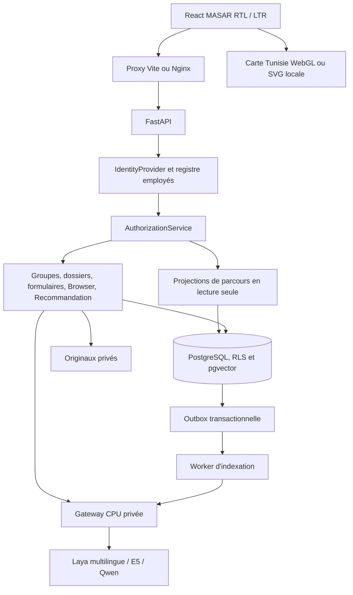

# Architecture MASAR — PoC du 16 novembre 2026, enrichi le 17 novembre

Le blueprint de 15 pages a été analysé avant les changements. Les sources existantes ont été sauvegardées et aucun projet indépendant n'a été créé. Le frontend reste à la racine dans `src/` pour préserver Vite et les composants existants ; il n'a pas été déplacé arbitrairement vers un second dossier frontend.

MASAR est un monolithe modulaire : API FastAPI, identité, autorisation, groupes, dossiers, documents, retrieval, Browser, moteur central, événements et workers. PostgreSQL est la source de vérité. Les modèles s'exécutent dans une gateway privée séparée pour isoler mémoire et calcul CPU ; ce n'est pas une multiplication de moteurs métier.

Les trois espaces principaux partagent l'autorisation. Assigned Children n'est pas un composant IA. Les suggestions textuelles et les questions explicites du Browser partagent le retrieval, mais seul un envoi explicite peut invoquer Qwen. Recommandation emploie un seul orchestrateur et des stratégies configurables par template.

Le **Forum / المنتدى** est un service d'échanges généraux synthétiques autorisés, conservés en PostgreSQL et limité aux centres, affectations et membres des conversations. Il n'emploie pas de modèle IA.

Le **Suivi du parcours de l'enfant / متابعة مسار الطفل** projette le dossier central. `backend/journey` expose les GET autorisés de vue collective, dossier, étapes et documents, ainsi que les commandes explicites de génération et revue des synthèses dérivées. Les compteurs et listes sont issus des mêmes lignes filtrées par RLS ; les droits du dossier et des preuves sont repris à chaque lecture. `journey_stage_summaries` est un historique dérivé sourcé et immuable, sans nouveau dossier métier ni décision automatisée. Les évaluations, plans et décisions de prolongation restent dans leurs tables existantes.

`src/features/child-journey` rassemble les composants de sélection, vue collective, carte, checkpoints, tooltip, panneau latéral, indicateurs, comparaisons qualitatives, historique des cycles et timeline. La carte ne reçoit que cinq résumés de checkpoints autorisés. Three.js est chargé à la demande et extrude la silhouette locale Natural Earth ; le rendu est déclenché par interaction ou changement de données. Un SVG interactif remplace automatiquement WebGL si nécessaire. Aucun appel cartographique externe et aucune position d'enfant ne sont utilisés. L'arabe RTL ne modifie pas le repère géographique. Les étapes avancées restent identifiées comme futures, même lorsque des traces historiques sont consultables. Voir [CHILD_JOURNEY.md](CHILD_JOURNEY.md).

La session est un cookie opaque HttpOnly dont le hash est stocké en base. DemoIdentityProvider résout une identité fictive ; EHouwiyaIdentityProvider est un adaptateur déconnecté, sans collecte d'identifiant national. Le backend relit rôles, centres, affectations et scopes, sans croire les attributs du navigateur.

L'entrée publique utilise désormais `/` (choix du gouvernorat), puis `/login` (composant existant conservé). Le catalogue bilingue central `config/governorates.json` alimente PostgreSQL et le frontend ; les frontières administratives SVG proviennent d'un GeoJSON local distinct de la roadmap 3D. Les migrations **018–020** relient les centres aux gouvernorats, classifient explicitement les données de démonstration et préservent les identifiants de référence vérifiés pendant la pseudonymisation. Le backend publie uniquement des centres et profils synthétiques en mode demo ; le bootstrap ne fournit plus d'annuaire global. `authz.entry_centre_allowed` vérifie compte, centre, appartenance, rôle, affectation datée et scope avant de créer une session ou choisir un centre. Le centre courant est un contexte de session, sans ajout de permission. Les professionnels multi-centres choisissent parmi leurs affectations vérifiées après identification. Les routes métier restent sous garde de session et les ouvertures de dossiers sont revérifiées côté serveur ; le retour interne est limité aux routes connues. Voir [AUTHENTICATION_FLOW.md](AUTHENTICATION_FLOW.md).

Le store Zustand est une projection API pseudonymisée. ApiRepository convertit les interactions historiques en commandes explicites ; aucun endpoint ne reçoit le snapshot complet. Les rafraîchissements concurrents sont regroupés et le filtrage de sortie s'exécute hors de la boucle asynchrone HTTP. L'ancien cache applicatif IndexedDB est invalidé au démarrage ; il n'est plus une source de données. Les originaux PostgreSQL et documents privés sont conservés. La rubrique d'identité utilise un état local temporaire distinct du store et une autorisation spécifique.

`backend/privacy` sépare `ChildSummaryDTO`, `ChildIdentityDTO` et `ChildJourneyDTO`. PostgreSQL attribue le `child_code` permanent ; des dossiers successifs réutilisent la même identité. Le pipeline de synthèse est : dossier central → autorisation → collecte de l'étape/cycle → pseudonymisation → contexte borné → passerelle CPU Qwen3 existante → validation de l'extrait et de ses références → brouillon → revue professionnelle → carte approuvée. Une indisponibilité locale produit un mode déterministe explicite, sans cloud. Les cartes HTML et connecteurs SVG suivent la projection Three.js, avec plein écran, historique et source viewer ; la 2D utilise les mêmes services. Voir [PRIVACY_JOURNEY_IMPLEMENTATION.md](PRIVACY_JOURNEY_IMPLEMENTATION.md).

Les sources de vérité sont les dossiers, documents et versions. Chunks, full-text et embeddings sont dérivés. La politique source est contrôlée en temps réel, avant matching, transmission au modèle et retour de citations. Les recommandations consultatives n'ont pas d'accès d'écriture au plan.

Quatre zones sont préparées : application (proxy/API), données (DB/originaux/indexer), IA (gateway/workers) et opérations (audit, registre, benchmarks, sauvegardes). Les modes Windows natif et Docker Linux complet ont été construits et exécutés localement. Compose définit des réseaux privés et un seul port d'interface sur 5180 ; le mode natif utilise 5173. Voir DEPLOYMENT.md et IMPLEMENTATION_STATUS.md.
